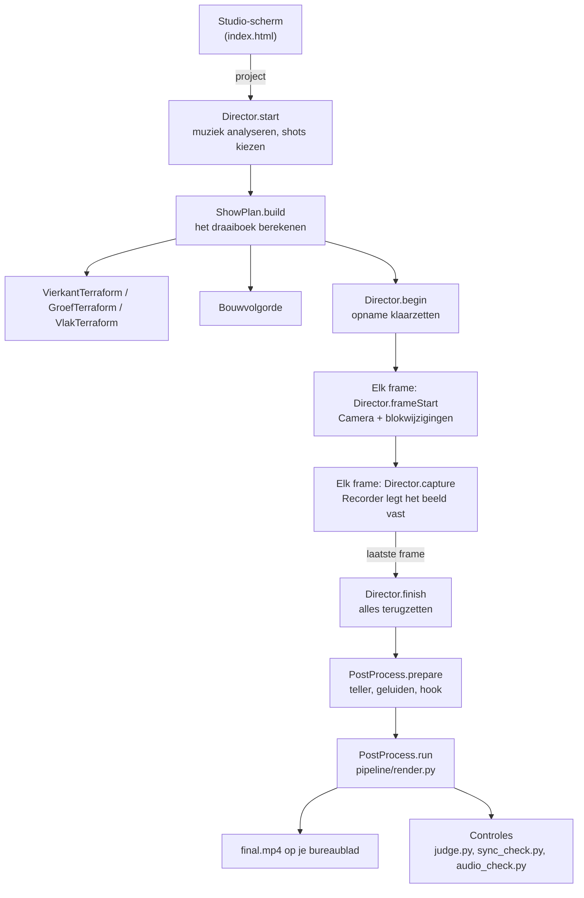

# Wegwijzer: waar staat wat?

Deze pagina legt uit hoe Regisseur Studio in elkaar zit, zonder programmeerkennis. Elke bestandsnaam is
klikbaar in je editor.

## Wat er gebeurt als je op "Opnemen" drukt



1. **Voorbereiden**: de mod leest je project, zoekt het tempo van de muziek en legt intro, terraform, bouw en
   outro op maatstarts. Dan berekent hij **vooraf** elke blokwijziging met een exact tijdstip: het draaiboek.
2. **Opnemen**: per frame zet de camera zich op zijn plek, gebeuren de blokwijzigingen van dat moment, en wordt
   het beeld vastgelegd. Is de laptop traag, dan duurt de opname langer, maar de video blijft perfect 60 fps.
3. **Afwerken**: de Python-pipeline maakt er een Short van met captions, teller, muziek en geluid, en controleert
   daarna alles automatisch.

## De mappen

### De mod (Java): `mod/src/client/java/be/studio/regisseur/`

| Map | Bestand | Wat het doet |
|---|---|---|
| (hoofdmap) | [RegisseurClient.java](mod/src/client/java/be/studio/regisseur/RegisseurClient.java) | Start de mod en de webserver van het studio-scherm |
| | [Studio.java](mod/src/client/java/be/studio/regisseur/Studio.java) | Mappen, `config.json` en het projectbestand |
| `show/` | [Director.java](mod/src/client/java/be/studio/regisseur/show/Director.java) | De regisseur: voorbereiden, elk frame, afronden |
| | [Camera.java](mod/src/client/java/be/studio/regisseur/show/Camera.java) | Alle shots (dolly, ring, orbit, hero, reveal) en de camerabaan |
| | [ShowReport.java](mod/src/client/java/be/studio/regisseur/show/ShowReport.java) | Schrijft `show.json` met metingen voor de controles |
| `draaiboek/` | [ShowPlan.java](mod/src/client/java/be/studio/regisseur/draaiboek/ShowPlan.java) | Het draaiboek: lijst met blokwijzigingen en het uitvoeren ervan |
| | [VierkantTerraform.java](mod/src/client/java/be/studio/regisseur/draaiboek/VierkantTerraform.java) | Stijl "vierkant" (standaard): sleuf, uithollen, gras omhoog |
| | [GroefTerraform.java](mod/src/client/java/be/studio/regisseur/draaiboek/GroefTerraform.java) | Stijl "uitgraven": een lange groef |
| | [VlakTerraform.java](mod/src/client/java/be/studio/regisseur/draaiboek/VlakTerraform.java) | Stijl "vlakmaken": een ronde grasschijf |
| | [Bouwvolgorde.java](mod/src/client/java/be/studio/regisseur/draaiboek/Bouwvolgorde.java) | Wanneer elk blok van het bouwwerk verschijnt |
| | [Easing.java](mod/src/client/java/be/studio/regisseur/draaiboek/Easing.java) | Alle tempo-curves: ease-in/out en de puls op de tel |
| | [Terrein.java](mod/src/client/java/be/studio/regisseur/draaiboek/Terrein.java) | Grond, bomen, water herkennen; zichtlijn van de camera |
| | [Schematic.java](mod/src/client/java/be/studio/regisseur/draaiboek/Schematic.java) | Bouwwerken inlezen (`.schem`, `.nbt`, `.litematic`) |
| | [MusicSync.java](mod/src/client/java/be/studio/regisseur/draaiboek/MusicSync.java) | Tempo en maten van de muziek |
| | [FlyIn.java](mod/src/client/java/be/studio/regisseur/draaiboek/FlyIn.java) | Blokken die invliegen of op hun plek "poppen" |
| `opname/` | [Recorder.java](mod/src/client/java/be/studio/regisseur/opname/Recorder.java) | Rendert op 1080x1920 en stuurt elk frame naar FFmpeg |
| `nabewerking/` | [PostProcess.java](mod/src/client/java/be/studio/regisseur/nabewerking/PostProcess.java) | Na de opname: eindrender, kopie naar het bureaublad, controles |
| | [CounterData.java](mod/src/client/java/be/studio/regisseur/nabewerking/CounterData.java) | Gegevens en icoontjes voor de materiaalteller |
| | [SfxData.java](mod/src/client/java/be/studio/regisseur/nabewerking/SfxData.java) | Haalt de echte Minecraft-geluiden uit de game |
| `mixin/` | [GameRendererMixin.java](mod/src/client/java/be/studio/regisseur/mixin/GameRendererMixin.java) | Haakjes in Minecraft: hier roept het spel onze code aan per frame |

Het studio-scherm zelf: [index.html](mod/src/client/resources/assets/regisseur/ui/index.html).

### De pipeline (Python): `pipeline/`

| Bestand | Wat het doet |
|---|---|
| [render.py](pipeline/render.py) | De eindrender. `main()` toont de 6 stappen: tijdlijn, captions, teller, beeld, geluid, eindencode |
| [counter.py](pipeline/counter.py) | Tekent de materiaalteller (iconen en getallen) |
| [sfx.py](pipeline/sfx.py) | Mengt de Minecraft-geluiden op de juiste momenten |
| [synth.py](pipeline/synth.py) | De Regisseur Beat: maakt per video een EDM-track op het ritme van de show |
| [beats.py](pipeline/beats.py) | Vindt tempo en maten in een muziekbestand |
| [judge.py](pipeline/judge.py) | Controle beeld en geluid: formaat, kwaliteit (VMAF), luidheid, captions, teller |
| [sync_check.py](pipeline/sync_check.py) | Controle ritme: cuts op de maat, laag per laag, tempo, camera |
| [audio_check.py](pipeline/audio_check.py) | Controle geluid: geluid volgt beeld, drop op de bouw, geen klikken |

## Ik wil iets aanpassen: waar moet ik zijn?

| Ik wil... | Kijk in | Zoek naar |
|---|---|---|
| een shot anders laten bewegen | `show/Camera.java` | `pose()`, het blok `case "hero"` enz. |
| meer of andere shots | `show/Camera.java` | `buildShots()` |
| de terraform sneller of trager per stap | `draaiboek/VierkantTerraform.java` | `sqRingDur`, `sqHollowDur`, `sqRiseDur` |
| een andere tempo-curve | `draaiboek/Easing.java` | `easeS` (terraform), `easeBuild` (bouw) |
| de puls op de tel sterker of zwakker | `draaiboek/Easing.java` | `DEPTH` in `beatWarp` |
| de pauze tussen bouwlagen | `draaiboek/Bouwvolgorde.java` | `GAP` |
| de teller hoger, lager of groter | `pipeline/counter.py` | `TOP`, `ROWH`, `ICON`, `MAX_FS` bovenaan |
| de geluidseffecten luider of zachter | `pipeline/render.py` | `lm - 6` in `master_audio` (6 = zoveel LU onder de muziek) |
| de Regisseur Beat anders laten klinken | `pipeline/synth.py` | `PROG` (akkoorden), `render()` (drums en bas) |
| de hooktekst of de teaser | `nabewerking/PostProcess.java` | `"I mined {mined} blocks for this"` |
| een nieuwe instelling in het studio-scherm | `ui/index.html` | de lijsten `NUM` en `TXT` |

## Bouwen en testen

```
cd mod
gradlew.bat build          # maakt mod/build/libs/regisseur-<versie>.jar
quicktest.ps1 -Sheet naam  # volledige testopname in de testwereld + alle controles (15 min)
```

Installeren: Minecraft dicht, de jar naar `%APPDATA%\.minecraft\regisseur\mods` (oude eruit),
`pipeline\*.py` naar `%APPDATA%\.minecraft\regisseur\studio\pipeline`.
Technische details en geschiedenis: [CLAUDE.md](CLAUDE.md).
